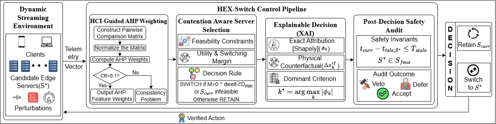

# HEX-Switch: Explainable and Safety-Audited Edge Server Switching for QoE-Aware Video Streaming

**HEX-Switch** is an autonomous, explainable client-side framework for Quality of Service (QoS)-aware edge server handover under dynamic network perturbations (wireless channel fading, telemetry measurement noise, local edge server processor congestion, and unannounced node outages).

---

## Key Architectural Highlights

HEX-Switch addresses the multi-criteria edge switching challenge through five mathematical and operational components:

1. **HCI-Guided Analytic Hierarchy Process (AHP) Weighting Engine**: Solves the principal eigenvector of pairwise preference matrices across five normalized QoS criteria (Latency, Effective Bandwidth, Server Load, Packet Loss, Availability) with guaranteed consistency ($\text{CR} < 0.016$, well below Saaty's 0.10 threshold).
2. **Contention-Aware (+1)-User Effective Bandwidth**: Explicitly models prospective multi-user fair-share degradation $b_{\mathrm{eff}}(s) = \min\left(C_{\mathrm{acc}}(s), \frac{C_{\mathrm{serv}}(s)}{N_{\mathrm{active}}(s) + 1}\right)$, suppressing multi-user herding oscillations under heavy load.
3. **Playout Buffer-Aware Dynamic Switching Hurdle & Noise Normalization**: Couples switching decisions to an online telemetry noise variance estimator $\hat{\sigma}$ and the client playout buffer state $\Lambda_{\mathrm{switch}}(B) = \lambda_0 [1.0 + \mu \cdot \max(0, \frac{\delta_{\mathrm{switch}} - B(t)}{\delta_{\mathrm{switch}}})]$, eliminating ping-pong handover churn while preserving emergency overrides.
4. **Exact Closed-Form Additive Shapley XAI & Counterfactual Inversion**: Provides feature attributions $\phi_k = w_k [u_k(s^*) - u_k(s_{\mathrm{curr}})]$ satisfying Shapley additive efficiency ($\sum \phi_k \equiv \Delta U$) and computes minimal physical counterfactual distance perturbations $\Delta x_k^{\mathrm{cf}}$ required to invert decisions.
5. **Sub-Millisecond In-Line Safety Auditor**: Deploys an edge-viable runtime supervisor ($< 45\,\mu\text{s}$ execution) enforcing five deterministic safety invariants: staleness detection, SLA feasibility verification, spurious handover prevention, playout buffer starvation protection, and weight normalization integrity.

---

---

## 🧠 System Overview

Below is the high-level architecture of the proposed framework:



---

## Repository Structure

```text
edge_switching_research/
├── configs/
│   ├── plot_style.mplstyle          # IEEE publication plotting style (Okabe-Ito, 800 DPI)
│   └── scenarios.yaml               # Canonical scenario configuration parameters
├── data/
│   ├── raw/                         # Raw network traces (CLUSTER '22, Puffer, Mobile 4G)
│   └── processed/                   # Normalized trace inputs and scenario feeds
├── experiments/
│   ├── plot_figures.py              # Vector PDF and 800 DPI PNG publication plot generator
│   ├── run_ablation_benchmark.py    # Architectural ablations & paired statistical significance
│   ├── run_auditor_benchmark.py     # Fault injection, confusion matrix & latency overhead
│   ├── run_baselines.py             # 8-policy baseline comparison & weight sensitivity
│   ├── run_scalability_benchmark.py # Multi-user client density & candidate server scaling
│   ├── run_scenarios.py             # Canonical scenario execution & trace replay
│   └── run_xai_benchmark.py         # Shapley XAI attributions, counterfactuals & stability
├── src/
│   └── edge_switching/              # Pure Python typed package
│       ├── __init__.py              # Package interface and public exports
│       ├── auditor.py               # Post-decision safety auditor & invariant verifier
│       ├── explainer.py             # Additive Shapley attributions & counterfactuals
│       ├── metrics.py               # Video QoE proxy, violations & dwell statistics
│       ├── policies.py              # ProposedMarginPolicy and 7 baseline policies
│       ├── py.typed                 # PEP 561 typing marker
│       ├── qos_model.py             # (+1)-user contention, SLA pruning & normalization
│       ├── scenarios.py             # 8 canonical evaluation scenarios
│       ├── simulator.py             # Discrete-event closed-loop edge simulator
│       ├── trace_loaders.py         # IEEE CLUSTER '22 and Stanford Puffer trace loaders
│       └── weighting.py             # AHP, Shannon Entropy, CRITIC, and Equal weighting
├── tests/                           # 63 unit and integration tests (100% pass rate)
├── environment.yml                  # Conda environment specification
├── pyproject.toml                   # Packaging and build configuration
├── .gitignore                       # Repository exclusion rules
└── README.md                        # Documentation
```

---

## Installation & Environment Setup

### Option A: Using Conda (Recommended)

```bash
# Clone the repository
git clone https://github.com/username/hex-switch.git
cd hex-switch

# Create and activate the conda environment
conda env create -f environment.yml
conda activate edge-switching
```

### Option B: Using Pip / Virtual Environment

```bash
python -m venv .venv
# On Linux/macOS:
source .venv/bin/activate
# On Windows:
.venv\Scripts\activate

# Install package in editable mode with dependencies
pip install -e .
pip install pytest pytest-cov
```

---

## Verification & Testing

Verify the complete installation by running the 63-test test suite:

```bash
pytest tests/ -v
```

All 63 tests cover:
- Closed-loop fair-share throughput convergence and multi-user coupling.
- Additive Shapley efficiency axiom ($\sum \phi_k \equiv \Delta U$).
- Exact counterfactual distance inversion and monotonicity.
- Post-decision safety auditor invariant checks across all 5 fault classes.
- AHP consistency verification ($\text{CR} < 0.016$) across literature profiles.
- Baseline policy behaviors (Nearest, Min-Latency, Max-Total-BW, Max-Effective-BW, AHP-TOPSIS, Hysteresis, QoE-Greedy).

---

## Reproducing Experiments & Benchmarks

Each benchmark outputs seed-level traces and statistical summaries to `logs/`:

### 1. Canonical Scenario Execution & Trace Replay
Runs the 8 canonical scenarios (noise, regime shifts, node failures, client mobility, real CLUSTER '22 and Puffer traces):
```bash
python experiments/run_scenarios.py
```

### 2. Baseline Benchmark & Weight Sensitivity Sweep
Executes 1,920 runs (8 policies $\times$ 8 scenarios $\times$ 30 independent seeds):
```bash
python experiments/run_baselines.py --baseline-seeds 30 --weight-seeds 30
```

### 3. XAI Explanations & Stability Benchmark
Computes exact Shapley attributions, counterfactual trajectories, and explanation stability under telemetry jitter:
```bash
python experiments/run_xai_benchmark.py
```

### 4. Safety Auditor & Faithfulness Verification
Runs 60 fault-injection trials per class, verifies counterfactual inversion monotonicity, and measures microsecond runtime overhead:
```bash
python experiments/run_auditor_benchmark.py
```

### 5. Multi-User Scalability & Candidate Scaling
Sweeps client density ($N=1$ to $100$) and candidate server pool size ($M=3$ to $32$):
```bash
python experiments/run_scalability_benchmark.py
```

### 6. Architectural Ablations & Paired Statistical Tests
Executes 5 architectural component ablations over 30 seeds and computes paired Wilcoxon signed-rank tests, Cohen's $d_z$, and Holm-Bonferroni corrected $p$-values:
```bash
python experiments/run_ablation_benchmark.py
```

---

## Generating Publication Figures

To generate the 8 finalized publication figures in both vector PDF and 800 DPI PNG format:

```bash
python experiments/plot_figures.py
```

Outputs are saved to `plots/`:
- `plot2_average_video_qoe.png`: Average video QoE comparison across all 8 policies.
- `plot3_qos_vs_dwell_stability.png`: Ping-pong switching rate (%) vs. mean dwell time (seconds).
- `plot6_criteria_weights_comparison.png`: AHP literature profiles vs. Shannon Entropy and CRITIC objective weights.
- `plot8_counterfactual_margins.png`: Decision margin $M(t)$, noise band, and regime shift handover trajectory.
- `plot9_explanation_stability_noise.png`: Dominant-criterion stability under stationary telemetry jitter.
- `plot11_counterfactual_faithfulness.png`: Monotonic counterfactual margin trajectories across QoS criteria.
- `plot14_server_scaling_complexity.png`: Algorithmic component execution overhead ($M=3$ to $32$ servers).
- `plot16_statistical_significance_pvalues.png`: Paired Cohen's $d_z$ effect sizes with Holm significance markers.

---

## License

This project is licensed under the MIT License — see the [LICENSE](LICENSE) file for details.